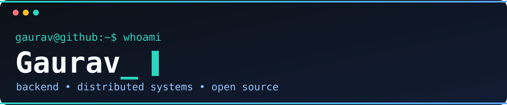

<div align="center">
  
  <br/><br/>
  
  <br/>
  
  <a href="https://github.com/Gaurav598?tab=followers"></a>
</div>

## `~/about`

```text
$ cat whoami.txt
Gaurav — software engineering student
Focus: backend architecture, full-stack products, distributed systems
Practice: build, test, observe, document, and improve real applications
Open source: contributions to Kubernetes and Kubernetes SIG projects
```

I enjoy connecting system design with working software: collaborative editing, real-time ride workflows, and concurrency-aware inventory. I am learning through implementation and review, including contributions to the Kubernetes ecosystem.

## `~/toolbox`

**Languages**

    

**Application development**

    

**Data and delivery**

     

## `~/open-source`

My Kubernetes work spans reliability, performance tooling, and documentation. These statuses were checked on **9 October 2026**.

| Status | Contribution |
| :--- | :--- |
| **Merged** | [kubernetes/perf-tests #4182](https://github.com/kubernetes/perf-tests/pull/4182) — clarified pod startup status reporting during rolling updates. |
| **Merged** | [kubernetes-sigs/dra-example-driver #259](https://github.com/kubernetes-sigs/dra-example-driver/pull/259) — recreated CDI specs when restoring prepared DRA claims. |
| **Open** | [kubernetes/kubernetes #141568](https://github.com/kubernetes/kubernetes/pull/141568) — retry failed pod deletions in taint eviction. |
| **Open** | [kubernetes/perf-tests #4358](https://github.com/kubernetes/perf-tests/pull/4358) — more precise ResourceClaim latency timestamps. |
| **Open** | [kubernetes/perf-tests #4183](https://github.com/kubernetes/perf-tests/pull/4183) — expose Go runtime metrics in benchmark results. |
| **Open** | [kubernetes/website #57960](https://github.com/kubernetes/website/pull/57960) — clarify reserved CPU precedence and cgroup compatibility. |

## `~/projects --featured`

### [CodeCollab — developer collaboration platform](https://github.com/Gaurav598/CodeCollab)

A multi-file coding workspace with Monaco, Yjs synchronization, chat, presence, and code execution. Its architecture separates a **Next.js/React frontend**, a **Spring Boot API**, and a **Node.js sync service**, with MongoDB and Redis supporting persistence and real-time behavior.

`Java` · `Spring Boot` · `TypeScript` · `Next.js` · `Yjs` · `MongoDB` · `Redis`

### [Flux — ride-booking platform](https://github.com/Gaurav598/Flux)

Passenger and rider mobile apps cover ride requests, bidding, status updates, and map-based ride flows. The repository contains **React Native apps**, a **Spring Boot backend**, PostgreSQL, Redis, and WebSocket messaging. Phone verification and location features are represented in source; the current payment service uses free subscriptions.

`React Native` · `Java` · `Spring Boot` · `PostgreSQL` · `Redis` · `WebSockets`

### [FlashFlow — distributed flash-sale engine](https://github.com/Gaurav598/FlashFlow-Distributed-Engine)

An inventory reservation experiment organized into API gateway, authentication, stock, and order services. The code uses **Node.js/Express**, **Redis**, MongoDB, containers, and Kubernetes manifests to explore contention and service isolation. The repository includes a k6 stress-test script; performance claims require reproducible results.

`JavaScript` · `Node.js` · `Redis` · `MongoDB` · `Docker` · `Kubernetes`

## `~/github --stats`

<div align="center">
  <a href="https://github.com/Gaurav598"></a>
  <a href="https://github.com/Gaurav598?tab=repositories"></a>
</div>

These images are supplied by a third-party service and may occasionally be unavailable. [Browse my repositories directly](https://github.com/Gaurav598?tab=repositories).

## `~/practice`

I practice data structures and algorithms alongside backend fundamentals, design patterns, and system design. My **September 2026 self-reported** progress was **343 LeetCode problems** and **404 Take U Forward problems**; the sets may overlap and are not a unique total.

## `~/activity`

<div align="center">
  <a href="https://github.com/Gaurav598?tab=overview"></a>
</div>

<details>
<summary>Contribution snake</summary>

<picture>
  <source media="(prefers-color-scheme: dark)" srcset="https://raw.githubusercontent.com/Gaurav598/Gaurav598/output/github-contribution-grid-snake-dark.svg" />
  <source media="(prefers-color-scheme: light)" srcset="https://raw.githubusercontent.com/Gaurav598/Gaurav598/output/github-contribution-grid-snake.svg" />
  
</picture>

</details>

## `~/connect`

[](https://github.com/Gaurav598)

Open an issue in a relevant repository for project-specific discussion. I have omitted unverified personal contact links.

<div align="center"><sub>Thanks for visiting. Explore the code, issues, and contribution history behind the work.</sub></div>
