<picture>
  <source media="(max-width: 600px)" srcset="assets/systems-hero-mobile.svg" />
  
</picture>

  <strong>Software engineering student building real-time products and resilient backend systems.</strong> 
  <a href="https://gaurav598.github.io/PortFolio/"><strong>View Portfolio ↗</strong></a>
  &nbsp;·&nbsp; <a href="https://www.linkedin.com/in/gaurav-thakur-193619321/">LinkedIn</a>
  &nbsp;·&nbsp; <a href="https://github.com/Gaurav598">GitHub</a>

## About

I am Gaurav, focused on backend engineering, full-stack development, distributed systems, and Kubernetes open source. I like connecting system design to working software: collaborative editing, real-time ride workflows, and concurrency-aware inventory.

I completed a **three-month Software Engineering Trainee internship at FamilyShell**. I continue to learn through implementation, testing, documentation, and upstream review.

## Engineering Toolkit

**Languages** &nbsp;     

**Backend & data** &nbsp;    

**Interfaces & delivery** &nbsp;    

Also used in current projects: MongoDB, WebSockets, and GitHub Actions.

## Kubernetes Open Source

Two contributions have been **merged upstream**. Four more are **open for review**. Statuses checked on **9 October 2026**.

**Merged upstream**

| Contribution | Change |
| :--- | :--- |
| [kubernetes/perf-tests #4182](https://github.com/kubernetes/perf-tests/pull/4182) | Clarified pod startup status reporting during rolling updates. |
| [kubernetes-sigs/dra-example-driver #259](https://github.com/kubernetes-sigs/dra-example-driver/pull/259) | Recreated CDI specs when restoring prepared DRA claims. |

**Open for review**

- [kubernetes/kubernetes #141568](https://github.com/kubernetes/kubernetes/pull/141568) — retry failed pod deletions in taint eviction.
- [kubernetes/perf-tests #4358](https://github.com/kubernetes/perf-tests/pull/4358) — more precise ResourceClaim latency timestamps.
- [kubernetes/perf-tests #4183](https://github.com/kubernetes/perf-tests/pull/4183) — expose Go runtime metrics in benchmark results.
- [kubernetes/website #57960](https://github.com/kubernetes/website/pull/57960) — clarify reserved CPU precedence and cgroup compatibility.

## Featured Projects

### 01 · [CodeCollab](https://github.com/Gaurav598/CodeCollab) — Developer Collaboration

A multi-file coding workspace with Monaco, Yjs synchronization, chat, presence, and code execution. The architecture separates a **Next.js/React frontend**, **Spring Boot API**, and **Node.js sync service**, backed by MongoDB and Redis.

**System shape:** `Next.js / React` → `Spring Boot` + `Node.js sync` → `MongoDB / Redis`

### 02 · [Flux](https://github.com/Gaurav598/Flux) — Ride Booking

Passenger and rider mobile apps cover ride requests, bidding, status updates, and map-based flows. The repository contains **React Native apps**, a **Spring Boot backend**, PostgreSQL, Redis, and WebSocket messaging. Phone verification and location features are represented in source; its current payment service uses free subscriptions.

**System shape:** `React Native` → `Spring Boot / WebSockets` → `PostgreSQL / Redis`

### 03 · [FlashFlow](https://github.com/Gaurav598/FlashFlow-Distributed-Engine) — Flash-Sale Inventory

An inventory reservation experiment with gateway, authentication, stock, and order services. It uses **Node.js/Express**, Redis, MongoDB, containers, and Kubernetes manifests to explore contention and service isolation. A k6 script supports repeatable load experiments.

**System shape:** `API gateway` → `Auth / Stock / Order services` → `Redis / MongoDB`

## GitHub Statistics

  
  

[Explore the repositories directly](https://github.com/Gaurav598?tab=repositories) if these third-party images are unavailable.

## Problem Solving

I practice data structures and algorithms alongside backend fundamentals, design patterns, and system design. My **September 2026 self-reported** progress was **343 LeetCode problems** and **404 Take U Forward problems**; these sets may overlap and are not a unique total.

## Contribution Activity

<picture>
  <source media="(prefers-color-scheme: dark)" srcset="https://raw.githubusercontent.com/Gaurav598/Gaurav598/output/github-contribution-grid-snake-dark.svg" />
  <source media="(prefers-color-scheme: light)" srcset="https://raw.githubusercontent.com/Gaurav598/Gaurav598/output/github-contribution-grid-snake.svg" />
  
</picture>

[View my contribution history on GitHub](https://github.com/Gaurav598?tab=overview).

## Connect

[**Portfolio**](https://gaurav598.github.io/PortFolio/) · [**LinkedIn**](https://www.linkedin.com/in/gaurav-thakur-193619321/) · [**GitHub**](https://github.com/Gaurav598)

For project-specific discussion, open an issue in the relevant repository.
