<picture>
  <source media="(max-width: 600px)" srcset="assets/hero-animated-mobile.svg" />
  
</picture>

  <strong>Building real-time products and learning how systems behave under load.</strong> 
  <a href="https://gaurav598.github.io/PortFolio/"><strong>View portfolio ↗</strong></a>
  &nbsp;·&nbsp; <a href="https://www.linkedin.com/in/gaurav-thakur-193619321/">LinkedIn</a>
  &nbsp;·&nbsp; <a href="https://github.com/Gaurav598?tab=repositories">Repositories</a>

## 01 · About

I am Gaurav, a software engineering student focused on backend engineering, distributed systems, and practical full-stack development. I build to understand the details: shared state in a collaborative editor, changing ride state across two mobile apps, inventory under contention, and the tools around an AI coding agent.

I completed a **three-month Software Engineering Trainee internship at FamilyShell**. Contributing to established open-source projects has also taught me to read unfamiliar code, test changes, and work through upstream review.

## 02 · Open Source Engineering

**3 merged upstream** &nbsp;·&nbsp; **14 open upstream** &nbsp;·&nbsp; **7 organizations** &nbsp;·&nbsp; **1 highlighted bug report** 
_GitHub PR states checked 16 October 2026. “Open” means proposed, not merged._

**Merged upstream**

- **[apache/beam #40496](https://github.com/apache/beam/pull/40496)** — added opt-in lazy Dask side inputs with worker-safe partition computation.
- **[apache/beam #40631](https://github.com/apache/beam/pull/40631)** — proposes preserving HTTP errors when quota responses have non-JSON bodies.
- **[kubernetes/perf-tests #4182](https://github.com/kubernetes/perf-tests/pull/4182)** — clarified pod startup status messages during rolling updates.
- **[kubernetes-sigs/dra-example-driver #259](https://github.com/kubernetes-sigs/dra-example-driver/pull/259)** — restored CDI specs when prepared DRA claims are recovered from a checkpoint.

**Open · Kubernetes ecosystem**

- **[kubernetes/kubernetes #141568](https://github.com/kubernetes/kubernetes/pull/141568)** — proposes durable, rate-limited retries for failed taint-eviction pod deletions.
- **[kubernetes/kubernetes #143105](https://github.com/kubernetes/kubernetes/pull/143105)** — proposes the default dialer when connection-rotation receives a nil dial callback.
- **[kubernetes/perf-tests #4358](https://github.com/kubernetes/perf-tests/pull/4358)** — proposes more precise timestamps for ResourceClaim latency measurements.
- **[kubernetes/perf-tests #4183](https://github.com/kubernetes/perf-tests/pull/4183)** — proposes Go runtime memory, GC, and allocation metrics in benchmark results.
- **[kubernetes/test-infra #38012](https://github.com/kubernetes/test-infra/pull/38012)** — proposes routing triage bug reports to the repository selected by the Repo filter.
- **[kubernetes/website #57960](https://github.com/kubernetes/website/pull/57960)** — proposes clearer `reservedSystemCPUs` precedence and incompatible kubelet cgroup settings.

**Open · Google Research and GoogleTest**

- **[google-research/google-research #3447](https://github.com/google-research/google-research/pull/3447)** — proposes avoiding gradient mutation in Shampoo SGD grafting.
- **[google-research/google-research #3449](https://github.com/google-research/google-research/pull/3449)** — proposes correct Shampoo optimizer state initialization on CPU.
- **[google/googletest #5123](https://github.com/google/googletest/pull/5123)** — proposes aggregate skipped-test counts in GoogleTest XML output.
- **[google/googletest #5125](https://github.com/google/googletest/pull/5125)** — proposes correct JSON output for quoted `RecordProperty` keys.

**Open · Apache Beam**

- **[apache/beam #40625](https://github.com/apache/beam/pull/40625)** — proposes resolving string annotations in callable type hints.

**Open · Redis**

- **[redis/redis #15923](https://github.com/redis/redis/pull/15923)** — proposes a bounded `redis-cli` cluster-join wait when cluster bus ports are unreachable.

**Highlighted bug report**

- **[Supabase issue #51827](https://github.com/supabase/supabase/issues/51827)** — Table Editor numeric filters round high-precision decimal values: JavaScript `Number` conversion changes PostgreSQL `numeric`/`decimal` filter inputs (closed).
- **[Supabase issue #51827](https://github.com/supabase/supabase/issues/51836)** — SQL Editor auto-limit turns LIMIT ALL and LIMIT NULL queries into invalid SQL: Auto-limit appends duplicate `LIMIT` clauses to otherwise valid PostgreSQL queries (closed).

## 03 · Featured Systems

Four projects, each centered on a different engineering problem and a concrete system to explore it.

<a href="https://github.com/Gaurav598/CodeCollab">
  <picture>
    <source media="(max-width: 600px)" srcset="assets/codecollab-card-mobile.svg" />
    
  </picture>
</a>

**[CodeCollab](https://github.com/Gaurav598/CodeCollab)** gives developers a shared, multi-file coding workspace. Monaco and Yjs handle collaborative editing; chat, presence, and code execution sit alongside a **Next.js frontend**, **Spring Boot API**, and **Node.js sync service**, with MongoDB and Redis.

<a href="https://github.com/Gaurav598/Flux">
  <picture>
    <source media="(max-width: 600px)" srcset="assets/flux-card-mobile.svg" />
    
  </picture>
</a>

**[Flux](https://github.com/Gaurav598/Flux)** coordinates passenger requests, rider bids, and changing ride status across two **React Native** apps. Its **Spring Boot** backend uses WebSockets, PostgreSQL, and Redis; the apps contain map and location flows. Flux is a **demo/test project**, and its current payment service uses free subscriptions.

<a href="https://github.com/Gaurav598/FlashFlow-Distributed-Engine">
  <picture>
    <source media="(max-width: 600px)" srcset="assets/flashflow-card-mobile.svg" />
    
  </picture>
</a>

**[FlashFlow](https://github.com/Gaurav598/FlashFlow-Distributed-Engine)** explores inventory reservation when many requests contend for limited stock. An API gateway separates authentication, stock, and order services; **Redis** coordinates stock operations, MongoDB stores service data, and Kubernetes manifests plus a k6 script support repeatable load experiments.

<a href="https://github.com/Gaurav598/NeuraSWE">
  <picture>
    <source media="(max-width: 600px)" srcset="assets/neuraswe-card-mobile.svg" />
    
  </picture>
</a>

**[NeuraSWE](https://github.com/Gaurav598/NeuraSWE)** is an AI coding-agent prototype that turns GitHub issues or Jira webhooks into queued runs. A **FastAPI** service, **arq/Redis** worker, and ReAct-style runtime connect repository search, file edits, Docker sandbox commands (with a local fallback), test execution, and optional pull-request creation. A **React** dashboard streams run activity; PostgreSQL stores run state.

## 04 · Engineering Toolkit

**Languages** &nbsp; Java · TypeScript · JavaScript · Python · SQL 
**Backend & real time** &nbsp; Spring Boot · Node.js · Express · FastAPI · WebSockets · Yjs 
**Data & messaging** &nbsp; PostgreSQL · MongoDB · Redis · arq 
**Product surfaces** &nbsp; React · Next.js · React Native 
**Infrastructure & tooling** &nbsp; Docker · Kubernetes · GitHub Actions · k6 
**Agent tooling explored in NeuraSWE** &nbsp; ChromaDB · Ollama · Docker sandboxing

## 05 · Activity & Practice

  
  

These third-party cards are optional visuals; [the repositories](https://github.com/Gaurav598?tab=repositories) remain the source of truth if a card is unavailable.

<picture>
  <source media="(prefers-color-scheme: dark)" srcset="https://raw.githubusercontent.com/Gaurav598/Gaurav598/output/github-contribution-grid-snake-dark.svg" />
  <source media="(prefers-color-scheme: light)" srcset="https://raw.githubusercontent.com/Gaurav598/Gaurav598/output/github-contribution-grid-snake.svg" />
  
</picture>

[View the contribution history directly](https://github.com/Gaurav598?tab=overview) if the animation is unavailable.

I practice data structures, algorithms, backend fundamentals, and system design. My **September 2026 self-reported** progress was **343 LeetCode problems** and **404 Take U Forward problems**. These sets may overlap; they are not a unique total.

## 06 · Connect

**[Portfolio](https://gaurav598.github.io/PortFolio/)** &nbsp;·&nbsp; **[LinkedIn](https://www.linkedin.com/in/gaurav-thakur-193619321/)** &nbsp;·&nbsp; **[GitHub](https://github.com/Gaurav598)**

For a project-specific discussion, open an issue in the relevant repository.
